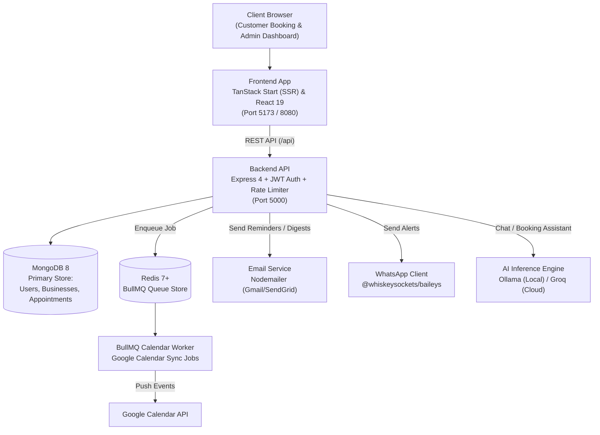

# CHROFA

AI-powered multi-tenant appointment scheduling and booking platform for service businesses.


<!-- HERO VISUAL: Add dashboard & booking preview screenshots when available -->
<!--
<picture>
  <source media="(prefers-color-scheme: dark)" srcset="docs/assets/chrofa-preview-dark.png">
  <source media="(prefers-color-scheme: light)" srcset="docs/assets/chrofa-preview-light.png">
  
</picture>
-->

CHROFA is a full-stack SaaS platform designed for service-based businesses (clinics, salons, consultancies, spas). It provides end-to-end appointment scheduling, real-time availability calculation, self-service customer booking flows, automated email and WhatsApp notifications, Google Calendar two-way synchronization, and an administrative management dashboard.

---

## Key Features

- **Public Self-Service Booking**: Dynamic customer-facing booking portals (`/book/:businessId`) with live slot availability, staff preference selection, and real-time conflict prevention.
- **Granular Availability Engine**: Calculates exact bookable slots per service based on business hours, staff working schedules, service duration, and existing commitments.
- **Multi-Channel Automated Messaging**: Sends confirmation emails, 24-hour advance customer reminder emails, provider notifications, weekly business performance digests via Nodemailer, and automated WhatsApp reminder alerts via Baileys.
- **Dual AI Engine**: Integrates local Ollama (`llama3.1`) and cloud Groq API (`llama-3.3-70b-versatile`) models for natural language appointment booking assistance and customer inquiries.
- **Google Calendar 2-Way Sync**: Synchronizes bookings with Google Calendar using BullMQ background queues and Redis, serializing updates and managing token lifecycle.
- **Comprehensive Admin Dashboard**: Manage appointments, review interactive day/week/month schedules, analyze revenue and booking volume metrics, and configure services, staff, and operating hours.
- **Hardened Security**: JWT authentication with rotating refresh tokens stored in secure `httpOnly` cookies, Google OAuth 2.0, bcrypt password hashing, Zod payload validation, and NoSQL injection protection.

---

## Tech Stack

| Layer | Technologies |
| :--- | :--- |
| **Frontend** | React 19, TanStack Start (SSR), TanStack Router, TanStack Query, Tailwind CSS v4, Radix UI primitives, Recharts, Lucide Icons, Vite 8, TypeScript 5.8 |
| **Backend API** | Node.js 22, Express 4.19, Passport.js (Google OAuth 2.0), Helmet, Zod, Morgan |
| **Database & Caching** | MongoDB 8 with Mongoose 8.4 ODM, Redis 7+ with `ioredis` 5.3 |
| **Background Queues** | BullMQ 5.7 (calendar synchronization workers) |
| **Messaging & Notifications** | Nodemailer (Gmail / SendGrid SMTP), `@whiskeysockets/baileys` (WhatsApp Web API client) |
| **AI Assistants** | Ollama (local LLM), Groq Cloud API (`llama-3.3-70b-versatile`) |

---

## Quick Start

### Prerequisites

- **Node.js**: v18.0.0 or higher (v22+ recommended)
- **MongoDB**: v6.0 or higher running locally on port 27017 (or MongoDB Atlas)
- **Redis** *(Optional)*: Redis v7+ running locally on port 6379 or Upstash for BullMQ background calendar sync
- **Ollama** *(Optional)*: Installed and running with `llama3.1` if using local AI features

> [!IMPORTANT]
> MongoDB must be running before starting the backend server. The backend verifies database connectivity and schema indexes on startup.

### 1. Clone & Install Dependencies

```bash
git clone <TODO: your-repo-url>
cd CHROFA

# Install root frontend dependencies
npm install

# Install backend dependencies
npm install --prefix server
```

### 2. Configure Environment Files

Create the frontend and backend environment configurations:

**Root `.env` (Frontend):**
```env
VITE_API_BASE_URL=http://localhost:5000/api
```

**`server/.env` (Backend):**
```env
PORT=5000
NODE_ENV=development
MONGODB_URI=mongodb://127.0.0.1:27017/cadence
REDIS_URL=redis://127.0.0.1:6379
ALLOWED_ORIGINS=http://localhost:3000,http://localhost:5173,http://localhost:8080
JWT_SECRET=replace_with_a_random_32_character_string_minimum

# Optional integrations
EMAIL_PROVIDER=gmail
GMAIL_USER=your-email@gmail.com
GMAIL_APP_PASSWORD=your-app-password
GOOGLE_CLIENT_ID=your-google-client-id
GOOGLE_CLIENT_SECRET=your-google-client-secret
GOOGLE_CALLBACK_URL=http://localhost:5000/api/auth/google/callback
```

### 3. Start Database & Services

Ensure MongoDB is started on your system:

```powershell
# Windows Service
net start MongoDB

# Or standalone daemon
mongod --dbpath <path-to-data-dir> --port 27017
```

### 4. Run the Application

Start the backend API and frontend development server in two separate terminals:

**Terminal 1 (Backend):**
```bash
npm run server
```
*API will run at `http://localhost:5000`.*

**Terminal 2 (Frontend):**
```bash
npm run dev
```
*Vite will start the client portal at `http://localhost:5173` (or `http://localhost:8080`).*

---

## Configuration

### Backend Environment Variables (`server/.env`)

| Variable | Required? | Default / Example | Purpose |
| :--- | :--- | :--- | :--- |
| `PORT` | No | `5000` | Port Express server listens on |
| `NODE_ENV` | No | `development` | Environment mode (`development`, `production`, `test`) |
| `MONGODB_URI` | **Yes** | `mongodb://127.0.0.1:27017/cadence` | MongoDB connection connection string |
| `JWT_SECRET` | **Yes** | *random string* | Secret used to sign auth tokens (min 32 chars) |
| `REDIS_URL` | No | `redis://127.0.0.1:6379` | Redis connection URL for BullMQ queue processing |
| `ALLOWED_ORIGINS` | No | `http://localhost:5173,...` | Comma-separated CORS allowed origins |
| `EMAIL_PROVIDER` | No | `gmail` | Email provider (`gmail` or `sendgrid`) |
| `GMAIL_USER` | No | `user@gmail.com` | Gmail sender address |
| `GMAIL_APP_PASSWORD`| No | *16-char app pass* | Gmail application-specific password |
| `GOOGLE_CLIENT_ID` | No | *oauth client id* | Google OAuth Client ID for login & calendar |
| `GOOGLE_CLIENT_SECRET` | No | *oauth secret* | Google OAuth Client Secret |
| `GOOGLE_CALLBACK_URL` | No | `http://localhost:5000/api/auth/google/callback` | OAuth redirect callback URI |
| `GROQ_API_KEY` | No | *gsk_...* | Cloud Groq LLM API Key |
| `GROQ_MODEL` | No | `llama-3.3-70b-versatile` | Model name for Groq inference |
| `OLLAMA_BASE_URL` | No | `http://127.0.0.1:11434` | Endpoint for local Ollama server |
| `OLLAMA_MODEL` | No | `llama3.1` | Local model name used for AI tasks |

---

## Usage

### Public Customer Booking Flow
Direct customers to the unique booking URL:
```text
http://localhost:5173/book/<BUSINESS_ID>
```
Customers can browse catalog services, filter by specialist, select available dates, and receive automated email confirmations.

### Health Check Endpoint
```bash
curl -X GET http://localhost:5000/api/health
```
```json
{
  "status": "healthy",
  "timestamp": "2026-10-30T10:00:00.000Z",
  "services": {
    "database": "connected",
    "redis": "connected"
  }
}
```

### Checking Real-time Slot Availability
```bash
curl -G http://localhost:5000/api/availability \
  --data-urlencode "businessId=65f1a2b3c4d5e6f7a8b9c0d1" \
  --data-urlencode "date=2026-11-15" \
  --data-urlencode "serviceId=65f1a2b3c4d5e6f7a8b9c0d2"
```

---

## Architecture



> [!NOTE]
> If Redis is not running or becomes unreachable, the server logs a notice and safely pauses BullMQ calendar sync jobs. All core booking, database, and auth operations continue to function uninterrupted.

---

## Project Structure

```text
CHROFA/
├── src/                          # Frontend source code
│   ├── routes/                   # TanStack Router route definitions (pages)
│   │   ├── index.tsx             # Marketing landing page
│   │   ├── book.$businessId.tsx  # Customer self-service booking page
│   │   ├── dashboard.*.tsx       # Business dashboard (calendar, appointments, analytics)
│   │   ├── onboarding.tsx        # Business onboarding wizard
│   │   └── login.tsx / signup.tsx# Authentication views
│   ├── components/               # Reusable UI components & shadcn/radix primitives
│   ├── hooks/                    # Custom React hooks (auth, availability, business)
│   ├── lib/                      # Utilities, API client configurations, date helpers
│   └── routeTree.gen.ts          # Auto-generated TanStack Router tree
├── server/                       # Backend API source code
│   ├── config/                   # Database (MongoDB), Redis, and Passport configurations
│   ├── controllers/              # Request handlers (auth, appointments, business, analytics)
│   ├── middleware/               # Auth guards, rate limiters, validation, error handlers
│   ├── models/                   # Mongoose schemas (User, Business, Appointment, Customer)
│   ├── queues/                   # BullMQ job queue definitions
│   ├── routes/                   # Express route dispatchers
│   ├── services/                 # Email, WhatsApp, AI (Groq/Ollama), and reminder schedulers
│   ├── workers/                  # BullMQ background workers (Google Calendar synchronization)
│   └── server.js                 # Server entry point and boot orchestration
├── tests/                        # Playwright end-to-end integration specs
├── AGENTS.md                     # Coding agent conventions and guidelines
├── vite.config.ts                # Vite & TanStack Start build configuration
└── package.json                  # Root monorepo / workspace script definition
```

---

## Scripts Reference

| Command | Working Directory | Description |
| :--- | :--- | :--- |
| `npm run dev` | Root | Starts frontend development server with HMR |
| `npm run build` | Root | Compiles client and SSR bundles with Vite |
| `npm run preview` | Root | Previews production frontend build locally |
| `npm run lint` | Root | Executes ESLint analysis |
| `npm run format` | Root | Runs Prettier to format source files |
| `npm run server` | Root | Boots the Express API server |
| `npm run server:dev` | Root | Starts the backend server with `nodemon` auto-reload |
| `npm test` | `server/` | Runs Jest integration tests for auth and appointments |

---

## Deployment

### Frontend (TanStack Start / Nitro)
The frontend application uses `@lovable.dev/vite-tanstack-config` with Vite and Nitro. Building via `npm run build` outputs:
- `dist/client/`: Static assets and client hydration bundle.
- `dist/server/`: Server-side rendering (SSR) entry point.

Deployable to Vercel, Netlify, Cloudflare Workers, or a Node.js SSR container.

### Backend (Express API)
The backend in `server/` is a standard Node.js Express process:
1. Provision a production Node.js 20+ runtime environment (Docker container, Railway, Render, Fly.io, or VPS).
2. Set environment variables from `server/.env.example` in your hosting dashboard.
3. Run `npm install --omit=dev` inside `server/`.
4. Execute `npm start` to run `node server.js`.

---

## Roadmap & Known Limitations

- **Redis Dependency for Calendar Sync**: Google Calendar synchronization depends on Redis and BullMQ. When Redis is unavailable, sync workers pause until Redis reconnects.
- **WhatsApp Pairing**: WhatsApp messaging requires initial manual QR code authorization via the settings view.
- **Timezone Standardization**: Appointments are stored in UTC Date objects; business timezone offsets are computed dynamically using IANA identifiers.

---

## Contributing

1. Check [AGENTS.md](AGENTS.md) for workflow rules, coding conventions, and setup requirements.
2. Create a feature branch: `git checkout -b feature/your-feature-name`.
3. Verify that changes build cleanly (`npm run build`).
4. Commit your changes and open a pull request.

---

## License & Contact

- **License**: Unlicensed / Proprietary (TODO: Add a `LICENSE` file if open sourcing under MIT or Apache 2.0).
- **Maintainer**: CHROFA Core Team (TODO: Add repository URL and maintainer contact details).

